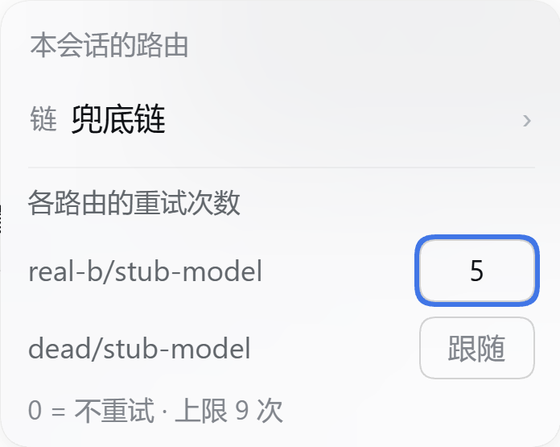
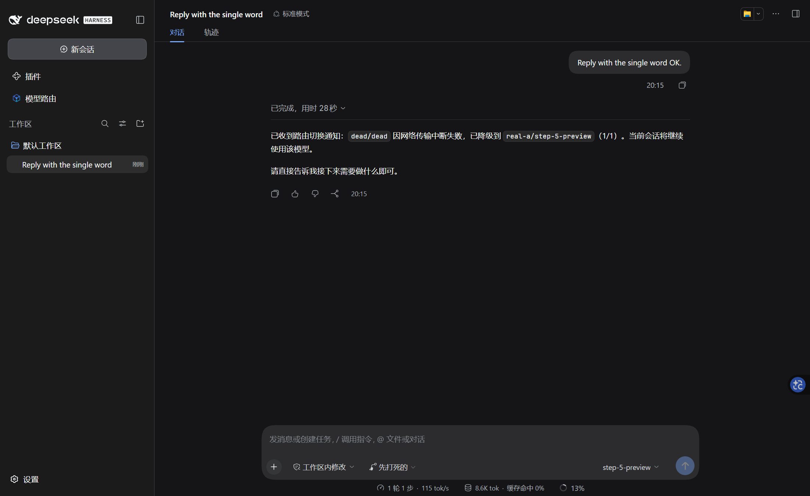
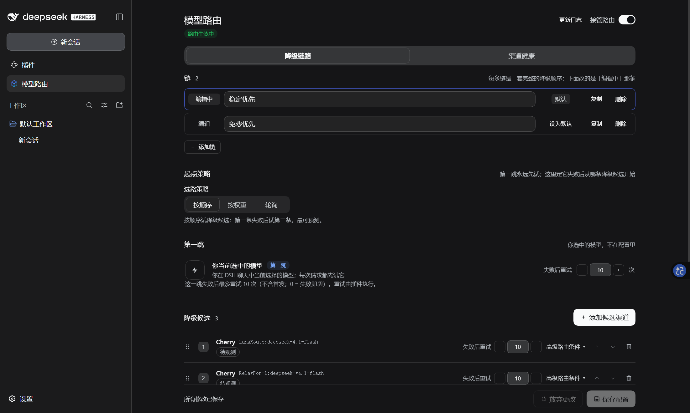
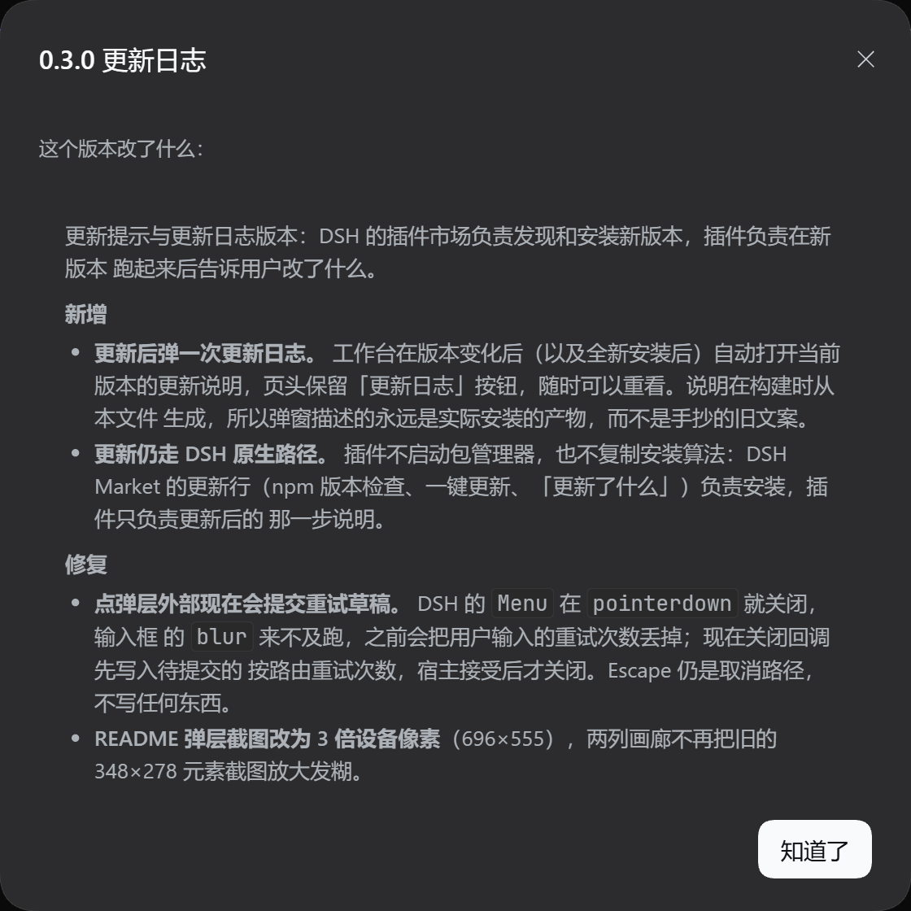

<p align="center">
  
</p>

<p align="center">
  <a href="https://github.com/Imzl-zl/dsh-models-router/actions/workflows/ci.yml"></a>
  <a href="https://www.npmjs.com/package/dsh-models-router"></a>
  <a href="https://github.com/Imzl-zl/dsh-models-router/blob/master/LICENSE"></a>
  <a href="https://github.com/deepseek-ai/deepseek-harness"></a>
</p>

<p align="center">
  简体中文 | <a href="README.en.md">English</a>
</p>

---

<p align="center">
  在 DSH 里照常选模型。它失败时，请求会沿着这个会话所绑定的链切到下一个物理渠道；对话里会说明失败码、最终应答的候选，以及这次切换为什么被允许。
</p>

## 功能

- **按会话选命名链** —— 多条降级链，各自有候选、失败切换规则和预算；直接在 composer 的 chip 里选，不另设会话管理页。
- **每路由重试次数覆盖** —— 会话可以覆盖某条路由的重试次数：`0` = 这条路由不重试，空 = 跟随链。
- **重试由插件执行** —— `switchOn` 勾选的失败码，填几次就是几次（不受 provider 重试策略封顶）；没勾的仍交给 DSH 的 `llm-retry`。
- **发起前预校验** —— 每个候选在真实调用前走 `ctx.llm.resolveCallConfig()`，不能服务的候选直接跳过，不白烧一次调用。
- **条件路由** —— 按候选的 `images` / `minContextTokens` 条件，以及按失败码的 `switchOn`。
- **渠道健康工作台** —— 零 Token 的被动延迟与吞吐、按需的 1-token 探测、按路由/按渠道的熔断，以及从 durable 会话日志折叠出的转移历史。
- **中英双语界面** —— 带未保存修改提示条。

## 截图

<table>
  <tr>
    <td width="50%"></td>
    <td width="50%"></td>
  </tr>
  <tr>
    <td><sub>链与每路由重试次数，在 composer 的 chip 里改。</sub></td>
    <td><sub>第一跳死掉后切到下一个候选，对话里会报告。</sub></td>
  </tr>
  <tr>
    <td></td>
    <td></td>
  </tr>
  <tr>
    <td><sub>命名链，各自有候选、失败切换规则和预算。</sub></td>
    <td><sub>更新到新版本后，工作台弹一次这一版改了什么。</sub></td>
  </tr>
</table>

截图来自隔离实例 + 真实网关；死路由是故意配的。

## 安装

需要 DSH `0.2.0-rc.2`。

```sh
dsh plugin add dsh-models-router
```

从源码安装（包名是 `dsh-models-router`；npm 上的 `dsh-model-router` 是另一个包）：

```sh
git clone https://github.com/Imzl-zl/dsh-models-router.git
cd dsh-model-router
npm install
npm run bundle --prefix packages/dsh-models-router
dsh plugin --profile web add packages/dsh-models-router
```

打开侧栏面板列表里的 **模型路由** 配置链。

## 更新

更新由 DSH 的插件市场（`dshmarket`）原生处理：在「插件」页打开已安装列表，它会按 npm 上的版本检查并提供 **一键更新**；有更新时每行还带 **更新了什么**，内容来自本仓库 GitHub Release 的 notes（即 `CHANGELOG.md` 的对应小节）。插件不自己启动包管理器，也不复制安装算法。

- **更新后**：新版本第一次打开工作台会弹一次该版本的更新日志；之后可从页头的「更新日志」按钮重看。
- **手动更新（CLI）**：`dsh plugin --profile <profile> remove dsh-models-router`，再 `dsh plugin --profile <profile> add dsh-models-router@latest`。
- **桌面版**：在应用自己的「设置 → 插件」里更新，不要直接改它管理的 profile。
- 版本记录：[CHANGELOG.md](CHANGELOG.md)。

## 配置

```yaml
enabled: true
defaultChainId: default          # 没有单独选链的会话走这条
chains:
  - id: default                  # 稳定 id：会话按它绑定
    name: ""                     # 留空 = 界面显示「默认链」
    candidates:                  # 降级候选；用户当前选中的模型是隐式第一跳
      - { provider: deepseek-official, model: deepseek-v4-flash, maxRetries: 1, needs: { images: false } }
      - { provider: pi-ai-gpt, model: gpt-5, maxRetries: 0, needs: { images: true } }
    switchOn: { rateLimit: true, server: true, timeout: true, transport: true, emptyResponse: false, invalidRequest: false, auth: true, quota: true }
    firstHopMaxRetries: 0        # 第一跳首发之后还能重试几次
    stickyTurns: 0               # 带图轮之后，继续按识图路由的无图轮数
    strategy: order
  - id: coding
    name: 写代码
    candidates: [...]
```

第一跳永远是你在 DSH 里选中的模型，不在配置里——链只回答「失败之后去哪」。旧的单 `chain` 配置（以及 2026-10-19 那版的 per-model `profiles`）在读取时迁成一条命名链，第一次保存写新形状。

## 工作原理

插件接管 Agent 循环的两个缝：

- **`agent/request`**（`prepend: true`）为每次尝试选物理路由。它在 `installModelSelection` 之外运行，所以用户选的模型永远先试，没有失败就不会切换。
- **`agent/request-error`**（`prepend: true`，最外层）先看到每次失败：`switchOn` 里的码，插件自己等一会儿重试，再往前推进；其它码交给 DSH，`llm-retry` 保留自己的次数与上限。

每次切换都从 durable 会话日志折叠进 `router/failover-history` 投影，在转移历史抽屉里展示。

## 项目结构

| 路径 | 是什么 |
|---|---|
| `packages/dsh-models-router/src/` | 插件：Host 半包（`index.ts`、`router.ts`、`bindings.ts`、`chain.ts`…）与浏览器半包（`src/client/`）。 |
| `packages/dsh-models-router/tests/` | 四套件：`unit`、`client-controller`、`remote`（进程内生产组合）、`run`（真 headless Loader 组合，逐场景）。 |
| `docs/design/` | 当前设计：路由提案、源码地图、能力边界、按会话选链、发布说明策略。 |
| `.agents/notes/` | 决策笔记（为什么、否掉了什么、代价是什么）。状态就是目录。 |
| `spike/` | Phase 1 实证产物，原样保留；不属于包。 |

## 开发

```sh
npm install                                                  # 根目录：DSH CLI 与 peer
npm ci --prefix packages/dsh-models-router --legacy-peer-deps # 包内：tsc、tsdown、typert 生成器
npm run bundle --prefix packages/dsh-models-router           # 构建 lib/（host + client + typert）
npm test                                                     # 四套件
```

单独跑某一套（组合套可带场景名）：

```sh
node packages/dsh-models-router/tests/unit.mjs
node packages/dsh-models-router/tests/client-controller.mjs
node packages/dsh-models-router/tests/remote.mjs
node packages/dsh-models-router/tests/run.mjs [scenario]
```

`lib/` 不进 git（在 `files` 里，npm 会发）；改源码后必须先 `npm run bundle`，浏览器与 Loader 才看得到，组合测试故意加载构建产物。

## 发布

```sh
npm version minor --prefix packages/dsh-models-router   # 0.2.0 → 0.3.0，先不打 tag
# 把 CHANGELOG 的 Unreleased 内容挪到新版本标题下
git add -A && git commit -m "chore(release): 0.3.0"
git tag -a v0.3.0 -m "dsh-models-router 0.3.0" && git push origin master v0.3.0
```

推 tag 就是发布：

- `.github/workflows/release.yml` 校验 tag 与包版本一致、构建 `lib/`、带 provenance（`--provenance`，public access）发 npm，并按 CHANGELOG 对应小节建 GitHub Release（`scripts/release-notes.mjs`）。
- 认证是 npm **trusted publishing**（OIDC）：npm 包设置里绑定了这个仓库与 workflow，CI 用短期 OIDC token 换发布权限并签名。没有 secret、没有 token 可轮换；npm 账号的 publishing access 设为「必须 2FA、禁止 bypass token」。
- `.github/workflows/ci.yml` 在每次 push `master` 与 PR 跑：构建、host 类型检查、四套件。

版本策略按 CHANGELOG：`1.0.0` 之前 minor 位是交付里程碑，插件对 DSH 的 peer 范围随之移动。

包名是 `dsh-models-router`：npm 上的 `dsh-model-router` 属于别人，所以安装命令、徽章、bundle patch 都用复数名。

## 限制

- **只管 Agent 主请求。** 压缩与会话标题调用仍走 DSH 自己的配置，不路由。
- **工具能力不预检。** DSH 没有机器可读的「支持 function calling」元数据；不兼容的候选会在运行时失败，由 `switchOn.invalidRequest` 处理。
- **通知是轨迹优先。** 切换通知走 durable 日志进「轨迹」；当前 DSH 版本不会在对话里单独渲染上下文行（对话里看到的是模型转述）。
- **fork 不继承会话绑定。** 新会话是新 sessionId，绑定按 sessionId 键控，所以 fork 出来回到默认链。
- **多个 DSH 进程同写一个 home 时**，绑定是整文件重写（后写覆盖先写）；单进程多会话不受影响。

## 友情链接

<p align="center">
  <a href="https://linux.do/" title="LINUX DO"></a><br>
  <a href="https://linux.do/">LINUX DO</a>
</p>

## 文档

设计理由、源码核实的能力边界与决策记录在 [`docs/design/`](docs/design/)；发布历史见 [CHANGELOG.md](CHANGELOG.md)。

## 许可证

[MIT](LICENSE)
