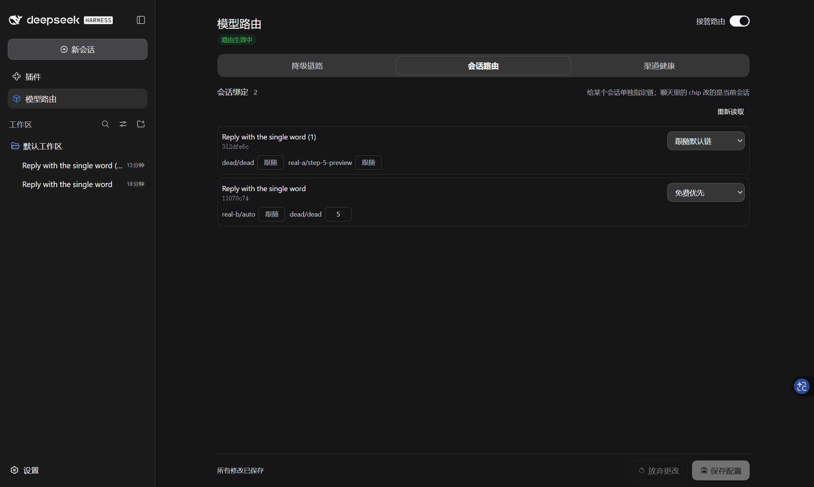
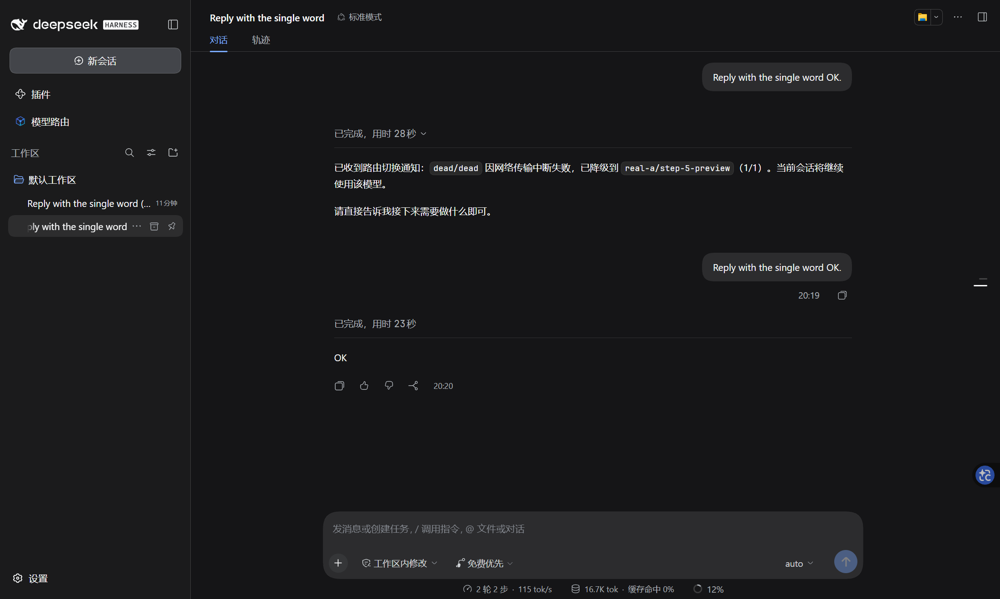

# dsh-models-router：给每个会话选降级链，按路由覆盖重试次数

> 发帖草稿。图片在本目录，上传到论坛后把 `./xxx.png` 换成图床地址即可。

DSH 的模型选择器是全局的，但不同会话干的是不同的活：写代码的会话想先试稳定渠道，闲聊的会话想先白嫖免费渠道。这个插件把降级顺序做成**命名链**，每个会话可以绑自己那条；每条路由的重试次数还能按会话覆盖——`0` 就是这条路由不重试，留空则跟随链。

## 两个入口

- **composer 里的路由 chip**：点开就是「链 + 各路由重试次数」，改完立刻生效。
- **设置面板 → 会话路由**：所有会话的绑定集中一页，适合批量调整。




## 它怎么走

第一跳永远是你当前选中的模型（不在配置里）。它失败后，才按本会话绑定的链往下走；链只排“失败之后”。重试次数 = **会话覆盖 ?? 该路由的链上次数**（降级候选取 `maxRetries`，首跳取 `firstHopMaxRetries`）；`0 = 不重试`，空 = 跟随链。


失败切换只接管 `switchOn` 里勾选的错误码；没勾的仍交给 DSH 自己的 `llm-retry`。勾选的那些，重试与退避由插件执行，填几次就是几次（不再被 provider 的重试策略封顶）。

## 实测（隔离进程 + 真实网关）

- 同一份配置，会话 A 覆盖 0 → 死路由只打 1 次；会话 B 覆盖 5 → 打满 6 次后切到 `real-a/step-5-preview`。差别只来自会话覆盖。
- 把 B 的覆盖改回 0，下一轮回到 1 次；改绑另一条链，备胎从 `step-5-preview` 换成 `real-b/auto`。
- 4 个会话并行跑，各自次数 1 / 2 / 4 / 3，互不串扰。
- 覆盖 `9`（上限）→ 10 次；链上 `firstHopMaxRetries: 5` + 空覆盖 → 6 次；给无关路由配次数不会泄漏到别的路由。
- 绑定指向已删除的链 → 按默认链路由 + 一条中文提示；删除绑定后下一轮回到默认链。



## 安装

```sh
dsh plugin add dsh-models-router
```

需要 DSH `0.2.0-rc.2`。仓库：<https://github.com/Imzl-zl/dsh-models-router>

## 已知边界

- **fork 不继承绑定**：新会话是新 sessionId，绑定按 sessionId 键控，所以 fork 出来会回到默认链。
- 切换通知走 durable 日志，在「轨迹」里以一条上下文消息展示；对话里看到的是模型对它的转述。
- 同一份 home 被多个 DSH 进程同时写绑定时，存储层是整文件重写（后写覆盖先写）；单进程多会话不受影响。
